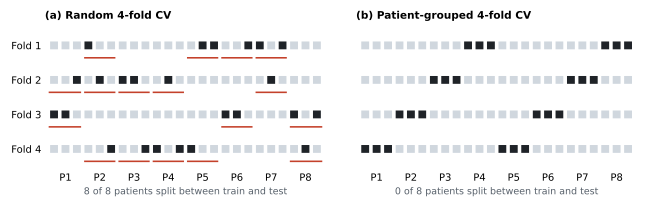
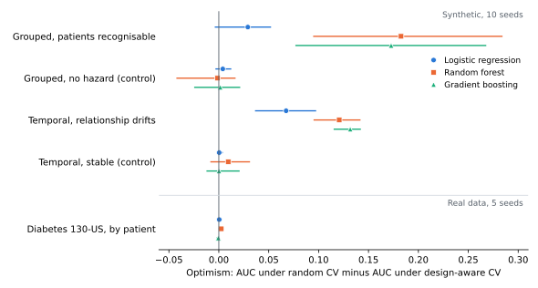

# ResearchGuard ML

[](https://github.com/kamaldeenjnr/researchguard-ml/actions/workflows/tests.yml)

[](LICENSE)


ResearchGuard checks whether a model was tested in a way that matches how the data were
collected, and estimates how much a mismatch changes the reported score.

The usual workflow shuffles rows and runs k-fold cross-validation. That is fine when rows are
independent. When the same patient, clinic or time period contributes several rows, a shuffled
split can put some of them in training and the rest in testing, and the model is then partly
tested on people it has already seen. ResearchGuard asks you to declare that structure, builds
splits that respect it, checks the folds, and reports the score both ways.



*Figure 1. Which visits are held out in each fold, for 8 patients with 3 visits each (dark = test).
Red lines mark a patient whose visits fall on both sides of that fold. Splits produced by
scikit-learn's `KFold` and `GroupKFold`.*

Status: v0.1.2, early research software. Binary outcomes and tabular data only. It describes
predictive performance; it is not causal inference or clinical validation.

## What it does

| Step | Module | Output |
|---|---|---|
| Data audit | `audit.py` | missing values, duplicates, constant columns, identifier-like columns, class imbalance, single features that separate the outcome almost perfectly |
| Validation design | `validation.py` | stratified, grouped or forward-in-time folds, chosen from the structure you declare. Structure that is only suspected from column names produces a warning; it is never assumed |
| Fold checks | `verify_plan` | groups shared across train and test, time-order violations, duplicated rows, folds missing a class |
| Modelling | `preprocessing.py`, `models.py` | logistic regression, random forest, gradient boosting; imputation, scaling and encoding fitted inside each training fold |
| Reliability | `metrics.py`, `calibration.py`, `subgroup.py` | ROC and PR AUC, Brier score, log-loss, calibration error, subgroup results (subgroups under 30 rows marked unreliable) |
| Optimism | `evaluate.compare_designs` | AUC under random CV minus AUC under the design-aware split |
| Report | `reporting.py` | JSON and Markdown, with configuration, seed, data fingerprint and library versions |

An example report on synthetic data (60 patients, 10 visits each) is in
[`examples/output/report.md`](examples/output/report.md). In that run, random CV placed all 60
patients on both sides of the split, and the random forest's AUC fell from 0.727 to 0.624 once
patients were held out together.

## Install and run

```bash
git clone https://github.com/kamaldeenjnr/researchguard-ml.git
cd researchguard-ml
python -m venv .venv && source .venv/bin/activate   # Windows: .venv\Scripts\activate
pip install -e ".[dev]"
pytest -q
python examples/binary_classification.py
```

Command line:

```bash
researchguard audit data.csv --target outcome
researchguard run data.csv --target outcome --positive-class yes \
    --group-col patient_id --subgroup sex --out report/
```

Python:

```python
from researchguard import build_report, to_markdown
report = build_report(df, target="outcome", positive_class="yes",
                      group_col="patient_id", subgroup_cols=["sex"])
print(to_markdown(report))
```

There is also a small web app: `pip install -e ".[app]" && streamlit run app/streamlit_app.py`.
Do not upload identifiable patient data to it.

## Results so far



*Figure 2. Optimism (random-CV AUC minus design-aware AUC) by scenario and model. Markers are
means and lines are the range across seeds. Synthetic scenarios are built to contain or lack a
known problem; the bottom row is real hospital data.*

**Real data.** The Diabetes 130-US hospitals dataset has 99,343 encounters (after removing
deaths and hospice discharges) from 69,990 patients; 16,341 patients have more than one
encounter. The outcome is readmission within 30 days. Over 5 seeds of 5-fold CV:

| Model | Random-CV AUC | Patient-grouped AUC | Optimism, mean (range) |
|---|---|---|---|
| Logistic regression | 0.656 | 0.655 | 0.000 (−0.001 to 0.003) |
| Random forest | 0.659 | 0.657 | 0.003 (−0.001 to 0.005) |
| Gradient boosting | 0.672 | 0.672 | 0.000 (−0.002 to 0.001) |

Random CV put about 20% of patients on both sides of the split in every seed, but the scores
hardly moved. With these features and models, repeat patients did not make the task easier.
That is a useful finding in itself: shared patients only inflate a score when a model can
recognise them, and that has to be measured for each dataset rather than assumed. Details are in
[`benchmarks/results/real_diabetes130.md`](benchmarks/results/real_diabetes130.md) and the script
is [`benchmarks/real/diabetes130.py`](benchmarks/real/diabetes130.py). Running on this dataset
also turned up three bugs, listed in the [changelog](CHANGELOG.md).

**Synthetic data.** Four scenarios, 10 seeds each
([full table](benchmarks/results/summary.md)):

| Scenario | Random forest | Gradient boosting | Logistic regression |
|---|---|---|---|
| Grouped, patients recognisable from their features | +0.18 | +0.17 | +0.03 |
| Grouped, no hazard (control) | −0.00 | +0.00 | +0.00 |
| Relationship drifts over time | +0.12 | +0.13 | +0.07 |
| Stable over time (control) | +0.01 | −0.00 | +0.00 |

These datasets were built to contain the problem, so they show the mechanism and that the
controls stay near zero. They say nothing about how common the problem is. Forests and boosting
pick up group signatures much more than logistic regression does. Reproduce with
`python benchmarks/run_benchmarks.py --seeds 10`; the figures are rebuilt with
`python docs/img/make_figures.py`.

## Testing and reproducibility

Each check is tested on data where it should fire and on clean data where it should stay quiet.
The test suite runs on Python 3.10, 3.11 and 3.12 on every push. Reports record the seed, a
fingerprint of the data, the configuration and library versions, and `verify_plan` re-checks
every fold rather than trusting the splitter.

The problem itself is well described in the literature: record-wise splits of repeated-measures
data overstate accuracy ([Saeb et al., 2017](https://doi.org/10.1093/gigascience/gix019)),
structured data need blocked cross-validation
([Roberts et al., 2017](https://doi.org/10.1111/ecog.02881)), and leakage is a common cause of
irreproducible results in ML-based science
([Kapoor & Narayanan, 2023](https://doi.org/10.1016/j.patter.2023.100804)).

## Limitations

Leakage cannot be detected reliably from column names and structure alone, so those findings
are marked "needs confirmation". Group and time structure cannot yet be combined in one design,
and models use default hyperparameters. More real datasets, especially time-ordered ones, are
needed. Full list: [`docs/limitations.md`](docs/limitations.md).

## Contributing

Real-data benchmark cases (with licence-compatible data), new checks with tests, and criticism
of the method are all welcome. See [`CONTRIBUTING.md`](CONTRIBUTING.md).

## Citing and licence

Citation details are in [`CITATION.cff`](CITATION.cff). MIT licence.
Written by [Amadu Kamal](https://modelanalysishub.com).
